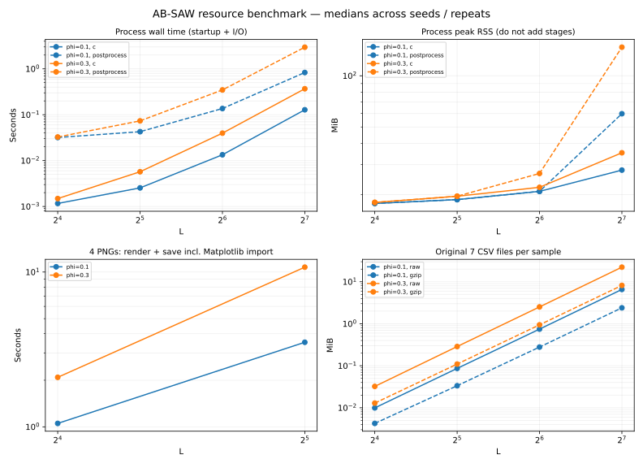

# 初期ベンチマークの例（2026-10-15）

これはCodex実行環境の測定であり、ユーザーのDELL PCの測定ではありません。
CPU: `AMD EPYC 9V74 80-Core Processor`。Python 3.12.14、Matplotlib 3.10.8。
コンパイラ: cc (Ubuntu 13.3.0-6ubuntu2~24.04) 13.3.0。既定CFLAGSは`-O2 -std=c11 -Wall -Wextra -Wpedantic -Werror`。
条件はconfig.json、OS・メモリ等はenvironment.jsonを参照してください。
生成コードは親コミット`6f50a4a05bbc1a3ac79cb682e21cdc77830d6f17`から変更していません。
性能測定スクリプトは開発中の実行であり、最終版ではその後に設定検査ログ・停止理由等の記録を補強しています。

L=16,32,64,128、phi=0.1,0.3、3seedで24試料。全試料が正常完了。
ウォームアップなし・逐次・起動込み。以下はphi=0.3の3seedの中央値です。

| L | 分子数 | C全体 [s] | Python後処理 [s] | 4 PNG描画保存 [s] | 元7 CSV [MiB] | gzip [MiB] |
|---:|---:|---:|---:|---:|---:|---:|
| 16 | 58 | 0.0015 | 0.033 | 2.09 | 0.032 | 0.013 |
| 32 | 468 | 0.0057 | 0.073 | 10.75 | 0.287 | 0.110 |
| 64 | 3744 | 0.0396 | 0.347 | 省略（分子数上限） | 2.517 | 0.942 |
| 128 | 29959 | 0.3682 | 2.963 | 省略（分子数上限） | 22.246 | 8.180 |

CSV・PNG・ログ・ソース等を含む全24試料の保存量は約59.8 MiBでした。
gzipはレベル1で、既存の予備測定におけるレベル9の容量とは同条件ではありません。
圧縮・復号照合の時間はCと後処理に含めず、cases.csvへ別記しています。

## 観測と解釈

- この範囲ではC処理よりPython後処理・PNG生成の時間が長い。
- L=128、phi=0.3のC最大RSS中央値は約35.2 MiB、Python後処理は約147.2 MiB。
- 小さいLのC最大RSSにはプロセス開始・exec前の高水位等が目立ち、一定部分を格子メモリとは解釈しない。
- Lが2倍になると体積と分子数が約8倍になる。CSVは桁数や結合数も変わるため厳密に8倍とは限らない。
- PNG生成は既存の描画実装・ライブラリimport・保存・グラフの枝数などにも依存し、Lだけで外挿しない。
- 全体描画を全試料へ適用せず、Cと必要な集計を全試料、詳細図を代表試料に絞る方針が妥当。

この結果だけでユーザーPCの最大Lやゲル化点は判定しません。ユーザーPCで同じ設定を測り、
時間・RSS・出力容量を確認してからL=192,256へ段階的に広げます。
今回の占有率2条件は性能確認用で、転移点推定や臨界指数の測定を目的に選んだ条件ではありません。
